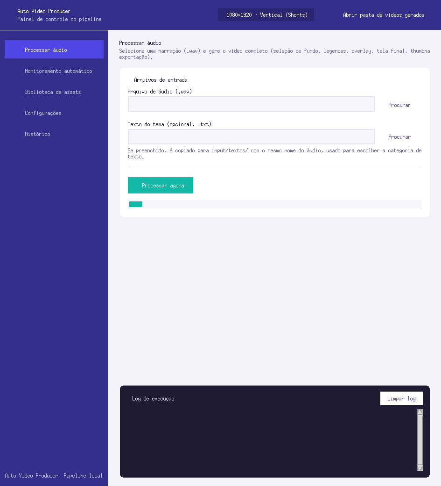
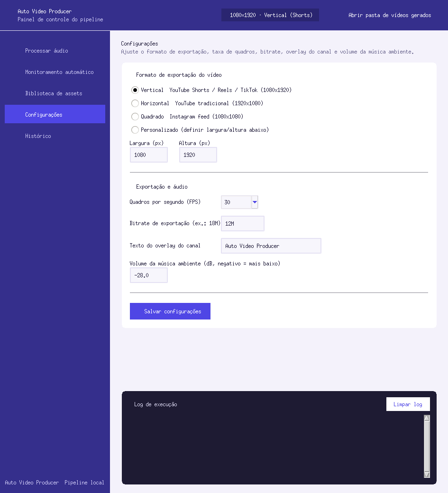
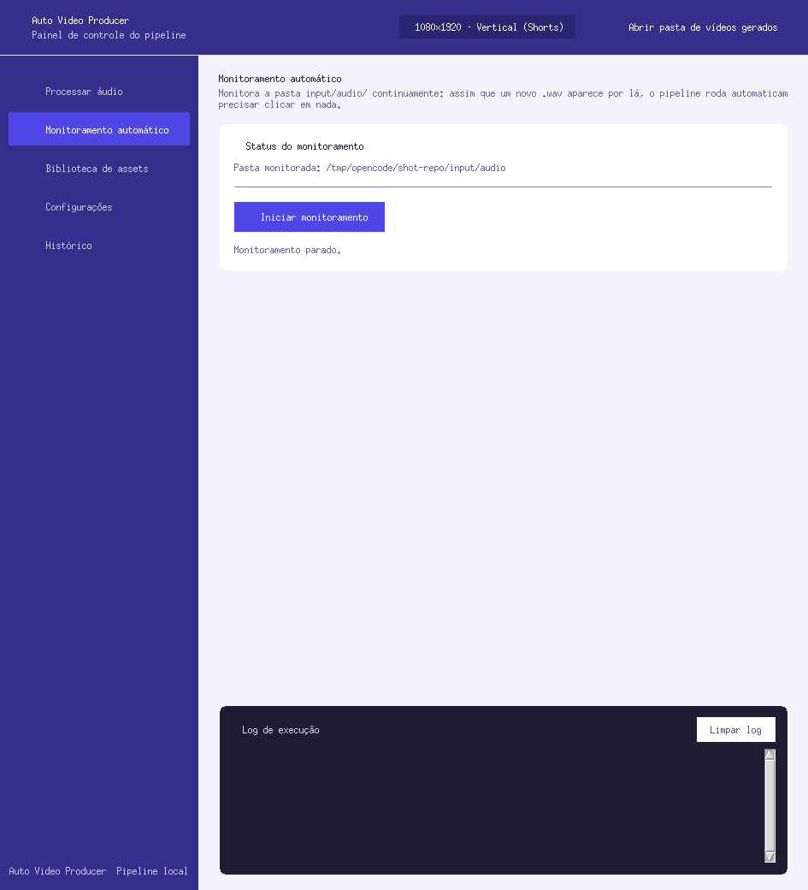
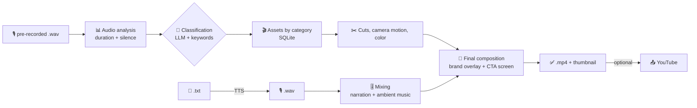

# Auto Video Producer

[Português (BR)](README.md) | **English**

[](https://www.python.org/)
[](LICENSE)
[](https://ffmpeg.org/)
[](#whitelabel-customization)

An automated, **100 % whitelabel** video production pipeline that turns text or
audio into finished videos: script → narration (TTS) → automated editing →
thumbnail. It works for **any channel, on any topic, in any language** — nothing
in the code is tied to a specific niche. Everything that gives the product its
identity (name, logo, CTA copy, themes, asset categories) lives in
`config.yaml` and in your own media folders.

<p align="center">
  
</p>

---

## Contents

- [Screenshots](#screenshots)
- [How it works](#how-it-works)
- [Requirements](#requirements)
- [Installation](#installation)
- [Configuration](#configuration)
- [Usage](#usage)
- [Folder structure](#folder-structure)
- [Whitelabel customization](#whitelabel-customization)
- [Colab notebooks](#colab-notebooks)
- [Troubleshooting](#troubleshooting)
- [Contributing](#contributing)

## Screenshots

| Process audio | Settings |
| --- | --- |
|  |  |

<p align="center">
  
</p>

*Tkinter UI with Material Design styling: brand bar (comes from `brand.*` in
the config), side navigation, cards, live log console, and tabs for
processing, monitoring, asset library, settings and history.*

## How it works



1. **Input** — a `.txt` in `input/textos/` or an already-recorded `.wav` in `input/audio/`.
2. **TTS** — OmniVoice (local, GPU) or Edge TTS (cloud, free) generates the audio.
3. **Analysis** — real narration duration and silence detection.
4. **Classification** — an OpenAI-compatible LLM picks the theme from the text;
   if it fails, a keyword fallback kicks in (works with no API key at all).
5. **Asset selection** — background videos and music picked from the categories
   available in the SQLite database.
6. **Editing** — resolution normalization, segment cuts, camera motion and
   color correction.
7. **Audio** — narration + ambient music mix with fades.
8. **Composition** — brand overlay, final CTA screen and export (`libx264` or
   `h264_nvenc`).
9. **Thumbnail** — sharpest frame + title, or your own image from `input/thumbs/`.
10. **Output** — `output/shorts/` (vertical) or `output/videos/` (landscape),
    plus a history entry.

## Requirements

- Python 3.11+
- **ffmpeg + ffprobe** on your PATH — `sudo apt install ffmpeg` / `brew install ffmpeg` / `winget install ffmpeg`
- NVIDIA GPU with CUDA *(optional)* — for OmniVoice and `h264_nvenc`; without a
  GPU the pipeline falls back to CPU + `libx264`
- An **OpenAI-compatible** API key (OpenRouter, Groq, Together, vLLM, …)
  *(optional)* — used for theme classification and, if you want, script
  generation
- Tkinter for the GUI (bundled with Python on most systems; on Debian/Ubuntu: `sudo apt install python3-tk`)

## Installation

```bash
git clone https://github.com/0xchrisoliveira/auto-video-producer.git
cd auto-video-producer

python -m venv .venv
source .venv/bin/activate        # Linux/macOS
# .venv\Scripts\activate         # Windows

pip install -r requirements.txt
```

## Configuration

```bash
cp config.yaml.example config.yaml
# edit config.yaml with your keys and your channel's identity
```

`config.yaml` is **not tracked** (it is in `.gitignore`): every clone keeps its
own file, so keys can never leak.

Main blocks:

| Block | Controls |
| --- | --- |
| `brand` | Name, tagline and icon shown in the GUI and overlay |
| `paths` | Inputs, assets, outputs and logs locations |
| `video` | Resolution, FPS, bitrate and codec (`h264_nvenc` or `libx264`) |
| `overlay` | Brand text/opacity over the video (uses the logo if present) |
| `final_screen` | CTA lines on the end screen |
| `classification` | Themes, keywords, categories and LLM endpoint |
| `tts` | Engine (`omnivoice` or `edge`), voice and speed |
| `llm` | Endpoint for script generation (optional) |
| `youtube` | OAuth2 files for upload (extension point) |

Example of branding and classification:

```yaml
brand:
  name: "My Channel"
  tagline: "New content every day"
  icon: "🎬"

classification:
  enabled: true
  endpoint: "https://openrouter.ai/api/v1/chat/completions"
  api_key: "YOUR_API_KEY"
  model: "anthropic/claude-3.5-sonnet"
  themes:
    cooking:
      keywords: ["recipe", "kitchen", "ingredient"]
      categories: ["home", "people"]
    technology:
      keywords: ["AI", "programming", "software"]
      categories: ["technology", "city"]
  default_categories: ["nature", "city", "people"]
```

> No API key? The pipeline still works: classification falls back to keyword
> matching using `classification.themes`.

## Usage

### CLI

```bash
# Full pipeline from text (TTS -> video)
python main.py run-text examples/roteiro_exemplo.txt

# Full pipeline from a pre-recorded audio file
python main.py run input/audio/my_narration.wav

# Index/refresh the asset library
python main.py scan

# Watch input/audio/ and process new files automatically
python main.py watch
```

### GUI

```bash
python gui.py
python gui.py --config path/to/other_config.yaml
```

Five tabs — **Process audio**, **Auto-monitoring**, **Asset library**,
**Settings** (format, FPS, bitrate, overlay, music volume) and **History** —
with a live execution log at the bottom.

## Folder structure

```
auto-video-producer/
├── core/                    # Python pipeline
│   ├── config.py           # Loads config.yaml and resolves paths
│   ├── pipeline.py         # Orchestrates: text/audio -> video
│   ├── tts_engine.py       # Text-to-Speech (OmniVoice + Edge TTS)
│   ├── classification.py   # Theme via LLM + keyword fallback
│   ├── audio_analysis.py   # Audio duration and levels
│   ├── audio_mixer.py      # Narration + ambient music mix
│   ├── video_processor.py  # Cuts, camera motion, color correction
│   ├── selectors.py        # Random pick of videos/music from the DB
│   ├── database.py         # SQLite asset and history store
│   ├── exporter.py         # Final composition + export (ffmpeg)
│   ├── final_screen.py     # CTA end screen
│   ├── overlay.py          # Brand overlay (logo or text)
│   ├── thumbnail.py        # Automatic thumbnail
│   ├── watcher.py          # Watches input/audio/
│   ├── organizer.py        # Moves processed files, writes history
│   ├── config_writer.py    # Persists GUI changes back to the YAML
│   └── logger_setup.py     # Structured logs + per-project report
├── config.yaml.example     # Configuration template
├── main.py                 # CLI entry point
├── gui.py                  # Graphical interface (Tkinter)
├── docs/screenshots/       # Screenshots used in this README
├── examples/               # Sample script you can run as-is
├── input/                  # User inputs (not tracked)
│   ├── audio/              # Narration .wav files
│   ├── textos/             # Texts for TTS
│   └── thumbs/             # Ready-made thumbnails (optional)
├── assets/                 # Media library (not tracked)
│   ├── videos/<category>/  # Backgrounds per category
│   ├── musicas/            # Ambient music
│   ├── fontes/             # .ttf/.otf fonts
│   ├── overlays/           # Fixed images
│   └── logo/               # Brand logo (PNG/WebP)
├── cache/  output/  database/  logs/   # Created at runtime
├── config.yaml             # Your local configuration (not tracked)
└── README.md
```

## TTS engines

| Engine | Type | Quality | Speed | Requirements |
|--------|------|---------|-------|------------|
| **OmniVoice** | Local (GPU/CPU) | High (*voice design*) | Medium | NVIDIA GPU recommended |
| **Edge TTS** | Cloud (Microsoft) | Good | Fast | Internet (free) |

```yaml
tts:
  provider: "omnivoice"        # or "edge"
  omnivoice:
    model_path: ""             # empty = automatic HuggingFace download
    voice_preset: "default"
    device: "auto"             # "cuda" | "cpu" | "auto"
  edge:
    voice: "en-US-GuyNeural"   # any supported locale
```

Automatic fallback: if OmniVoice fails, the pipeline retries with Edge TTS.

## Whitelabel customization

No content, niche or channel-specific string is hard-coded. To adopt the
project for a new channel, change configuration and media only:

| I want to change... | Where |
| --- | --- |
| Channel name / tagline / icon | `brand.*` in `config.yaml` |
| Video watermark | `overlay.text` or a PNG in `assets/logo/` |
| End-screen CTA copy | `final_screen.lines` |
| Themes, keywords and categories | `classification.themes` |
| Backgrounds per category | folders in `assets/videos/<category>/` |
| Background music | `assets/musicas/` |
| Narration language / voice | `tts.edge.voice` / `tts.omnivoice` |
| Thumbnail keywords | `thumbnail.preferred_keywords` |
| Format (Shorts, 16:9, 1:1) | GUI → *Settings*, or `video.*` |
| Codec / quality | `video.codec` (`libx264` without a GPU) |

After adding media, run `python main.py scan` to index it into the database.

## Colab notebooks

To run the heavy parts on Colab's free GPU:

- `Colab_AutoVideoProducer.ipynb` — full pipeline
- `baixar_assets.ipynb` — downloads stock videos/music to your Drive
- `omnivoice_colab.ipynb` — audio generation with OmniVoice

All of them point to `/content/drive/MyDrive/auto-video-producer/`.

## Troubleshooting

| Problem | Fix |
| --- | --- |
| `h264_nvenc` fails | Switch to `codec: "libx264"` under `video.*` |
| `tkinter` will not import | `sudo apt install python3-tk` (not a pip package) |
| Classification always returns default categories | Check `classification.enabled` and the `themes` map; with no text the pipeline shuffles all categories |
| Too few background videos | Create folders under `assets/videos/<category>/` and run `main.py scan` |
| OmniVoice will not install | Set `tts.provider: "edge"` |
| ffmpeg not found | Install it and make sure `ffmpeg`/`ffprobe` are on your PATH |

## Contributing

1. Fork the repository
2. Create a branch: `git checkout -b feature/your-feature`
3. Commit with clear messages (`git commit -m "feat: new TTS engine"`)
4. Open a *Pull Request*

## License

Distributed under the [MIT](LICENSE) license — free to use for any video
production project.
