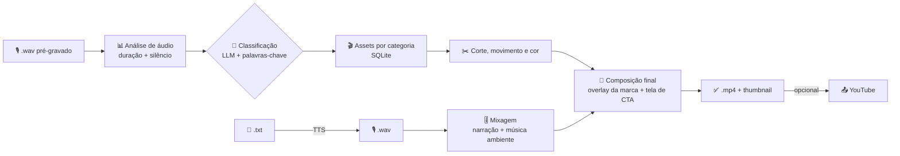

# Auto Video Producer

**Português (BR)** | [English](README.en.md)

[](https://www.python.org/)
[](LICENSE)
[](https://ffmpeg.org/)
[](#personalização-whitelabel)

Pipeline automatizado e **100 % whitelabel** para produção de vídeos a partir de
texto ou áudio: roteiro → narração (TTS) → edição automática → thumbnail.
Serve para **qualquer canal, sobre qualquer tema, em qualquer idioma** — nada no
código está amarrado a um nicho específico. Tudo o que dá "cara" ao produto
(nome, logo, textos de CTA, temas, categorias de assets) vive no `config.yaml`
e nas suas pastas de mídia.

<p align="center">
  
</p>

---

## Sumário

- [Capturas de tela](#capturas-de-tela)
- [Como funciona](#como-funciona)
- [Requisitos](#requisitos)
- [Instalação](#instalação)
- [Configuração](#configuração)
- [Uso](#uso)
- [Estrutura de pastas](#estrutura-de-pastas)
- [Personalização whitelabel](#personalização-whitelabel)
- [Notebooks Colab](#notebooks-colab)
- [Solução de problemas](#solução-de-problemas)
- [Contribuindo](#contribuindo)

## Capturas de tela

| Processar áudio | Configurações |
| --- | --- |
|  |  |

<p align="center">
  
</p>

*Interface Tkinter com Material Design: barra de marca (vem de `brand.*` no
config), navegação lateral, cartões, console de log em tempo real e abas para
processamento, monitoramento, biblioteca de assets, configurações e histórico.*

## Como funciona



1. **Entrada** — um `.txt` em `input/textos/` ou um `.wav` já gravado em `input/audio/`.
2. **TTS** — OmniVoice (local, GPU) ou Edge TTS (nuvem, gratuito) gera o áudio.
3. **Análise** — duração real da narração e detecção de silêncio.
4. **Classificação** — LLM compatível com OpenAI escolhe o tema a partir do
   texto; se falhar, há *fallback* por palavras-chave (funciona sem chave de API).
5. **Seleção de assets** — vídeos de fundo e música sorteados entre as
   categorias disponíveis no banco SQLite.
6. **Edição** — padronização de resolução, cortes em segmentos, movimento de
   câmera e correção de cor.
7. **Áudio** — mixagem narração + música ambiente com fades.
8. **Composição** — overlay da marca, tela final de CTA e exportação (`libx264`
   ou `h264_nvenc`).
9. **Thumbnail** — frame mais nítido + título, ou a imagem pronta em
   `input/thumbs/`.
10. **Saída** — `output/shorts/` (vertical) ou `output/videos/` (horizontal),
    mais registro no histórico.

## Requisitos

- Python 3.11+
- **ffmpeg + ffprobe** no PATH — `sudo apt install ffmpeg` / `brew install ffmpeg` / `winget install ffmpeg`
- GPU NVIDIA com CUDA *(opcional)* — para OmniVoice e `h264_nvenc`; sem GPU o
  pipeline usa CPU + `libx264`
- Chave de uma API **compatível com OpenAI** (OpenRouter, Groq, Together, vLLM,
  etc.) *(opcional)* — usada na classificação de tema e, se quiser, na geração
  de roteiros
- Tkinter para a GUI (já vem com o Python na maioria dos sistemas; em Debian/Ubuntu: `sudo apt install python3-tk`)

## Instalação

```bash
git clone https://github.com/0xchrisoliveira/auto-video-producer.git
cd auto-video-producer

python -m venv .venv
source .venv/bin/activate        # Linux/macOS
# .venv\Scripts\activate         # Windows

pip install -r requirements.txt
```

## Configuração

```bash
cp config.yaml.example config.yaml
# edite config.yaml com suas chaves e a identidade do seu canal
```

O `config.yaml` **não é versionado** (está no `.gitignore`): cada clone tem o
próprio, sem risco de vazar chaves.

Principais blocos:

| Bloco | O que controla |
| --- | --- |
| `brand` | Nome, slogan e ícone exibidos na GUI e no overlay |
| `paths` | Onde ficam entradas, assets, saídas e logs |
| `video` | Resolução, FPS, bitrate e codec (`h264_nvenc` ou `libx264`) |
| `overlay` | Texto/opacity da marca sobre o vídeo (usa o logo se existir) |
| `final_screen` | Linhas de CTA da tela final |
| `classification` | Temas, palavras-chave, categorias e endpoint do LLM |
| `tts` | Engine (`omnivoice` ou `edge`), voz e velocidade |
| `llm` | Endpoint para geração de roteiro (opcional) |
| `youtube` | Arquivos OAuth2 para upload (ponto de extensão) |

Exemplo de marca e classificação:

```yaml
brand:
  name: "Meu Canal"
  tagline: "Conteúdo novo todo dia"
  icon: "🎬"

classification:
  enabled: true
  endpoint: "https://openrouter.ai/api/v1/chat/completions"
  api_key: "SUA_API_KEY"
  model: "anthropic/claude-3.5-sonnet"
  themes:
    culinaria:
      keywords: ["receita", "cozinha", "ingrediente"]
      categories: ["casa", "pessoas"]
    tecnologia:
      keywords: ["IA", "programação", "software"]
      categories: ["tecnologia", "cidade"]
  default_categories: ["natureza", "cidade", "pessoas"]
```

> Sem chave de API o pipeline continua funcionando: a classificação cai para o
> modo por palavras-chave usando `classification.themes`.

## Uso

### CLI

```bash
# Pipeline completo a partir de texto (TTS -> vídeo)
python main.py run-text examples/roteiro_exemplo.txt

# Pipeline completo a partir de áudio pré-gravado
python main.py run input/audio/minha_narracao.wav

# Indexar/atualizar a biblioteca de assets
python main.py scan

# Monitorar input/audio/ e processar novos arquivos automaticamente
python main.py watch
```

### Interface gráfica

```bash
python gui.py
python gui.py --config caminho/para/outro_config.yaml
```

Cinco abas: **Processar áudio**, **Monitoramento automático**, **Biblioteca de
assets**, **Configurações** (formato, FPS, bitrate, overlay, volume da música) e
**Histórico**, com log de execução em tempo real na parte inferior.

## Estrutura de pastas

```
auto-video-producer/
├── core/                    # Pipeline Python
│   ├── config.py           # Carrega o config.yaml e resolve caminhos
│   ├── pipeline.py         # Orquestra: texto/áudio -> vídeo
│   ├── tts_engine.py       # Text-to-Speech (OmniVoice + Edge TTS)
│   ├── classification.py   # Tema via LLM + fallback por palavras-chave
│   ├── audio_analysis.py   # Duração e nível do áudio
│   ├── audio_mixer.py      # Mix narração + música ambiente
│   ├── video_processor.py  # Corte, movimento de câmera, correção de cor
│   ├── selectors.py        # Sorteio de vídeos/músicas do banco
│   ├── database.py         # SQLite de assets e histórico
│   ├── exporter.py         # Composição final + exportação (ffmpeg)
│   ├── final_screen.py     # Tela final de CTA
│   ├── overlay.py          # Overlay da marca (logo ou texto)
│   ├── thumbnail.py        # Thumbnail automática
│   ├── watcher.py          # Monitora input/audio/
│   ├── organizer.py        # Move/processa áudios e registra no banco
│   ├── config_writer.py    # Grava alterações feitas na GUI no YAML
│   └── logger_setup.py     # Logs estruturados + relatório por projeto
├── config.yaml.example     # Template de configuração
├── main.py                 # Entry point CLI
├── gui.py                  # Interface gráfica (Tkinter)
├── docs/screenshots/       # Capturas usadas neste README
├── examples/               # Roteiro de exemplo, pronto para rodar
├── input/                  # Entradas (não versionadas)
│   ├── audio/              # Narrações .wav
│   ├── textos/             # Textos para TTS
│   └── thumbs/             # Thumbnails prontas (opcional)
├── assets/                 # Biblioteca de mídia (não versionada)
│   ├── videos/<categoria>/ # Fundos por categoria
│   ├── musicas/            # Músicas ambiente
│   ├── fontes/             # Fontes .ttf/.otf
│   ├── overlays/           # Imagens fixas
│   └── logo/               # Logo da marca (PNG/WebP)
├── cache/  output/  database/  logs/   # Gerados em execução
├── config.yaml             # Sua configuração local (não versionada)
└── README.md
```

## Engines de TTS

| Engine | Tipo | Qualidade | Velocidade | Requisitos |
|--------|------|-----------|------------|------------|
| **OmniVoice** | Local (GPU/CPU) | Alta (*voice design*) | Média | GPU NVIDIA recomendada |
| **Edge TTS** | Nuvem (Microsoft) | Boa | Rápida | Internet (gratuito) |

```yaml
tts:
  provider: "omnivoice"        # ou "edge"
  omnivoice:
    model_path: ""             # vazio = download automático do HuggingFace
    voice_preset: "default"
    device: "auto"             # "cuda" | "cpu" | "auto"
  edge:
    voice: "pt-BR-AntonioNeural"   # qualquer locale suportada
```

Há *fallback* automático: se o OmniVoice falhar, o pipeline tenta o Edge TTS.

## Personalização whitelabel

Nada de conteúdo, nicho ou canal específico está escrito no código. Para
adotar o projeto em um novo canal, troque apenas configuração e mídia:

| Quero mudar... | Onde |
| --- | --- |
| Nome/slogan/ícone do canal | `brand.*` no `config.yaml` |
| Marca d'água no vídeo | `overlay.text` ou um PNG em `assets/logo/` |
| Textos da tela final (CTA) | `final_screen.lines` |
| Temas, palavras-chave e categorias | `classification.themes` |
| Fundos por categoria | pastas em `assets/videos/<categoria>/` |
| Música de fundo | `assets/musicas/` |
| Idioma/voz da narração | `tts.edge.voice` / `tts.omnivoice` |
| Palavras-chave da thumbnail | `thumbnail.preferred_keywords` |
| Formato (Shorts, 16:9, 1:1) | GUI → *Configurações*, ou `video.*` |
| Codec/qualidade | `video.codec` (`libx264` sem GPU) |

Depois de adicionar mídia, rode `python main.py scan` para indexar no banco.

## Notebooks Colab

Para rodar as partes pesadas na GPU gratuita do Colab:

- `Colab_AutoVideoProducer.ipynb` — pipeline completo
- `baixar_assets.ipynb` — baixa vídeos/músicas de stock para o Drive
- `omnivoice_colab.ipynb` — geração de áudio com OmniVoice

Todos apontam para `/content/drive/MyDrive/auto-video-producer/`.

## Solução de problemas

| Problema | Solução |
| --- | --- |
| `h264_nvenc` falha | Troque para `codec: "libx264"` em `video.*` |
| `tkinter` não importa | `sudo apt install python3-tk` (não é pacote pip) |
| Classificação sempre nas categorias padrão | Verifique `classification.enabled` e a chave `themes`; sem texto, o pipeline sorteia entre as categorias |
| Poucos vídeos de fundo | Crie pastas em `assets/videos/<categoria>/` e rode `main.py scan` |
| OmniVoice não instala | Use `tts.provider: "edge"` |
| ffmpeg não encontrado | Instale e garanta que `ffmpeg`/`ffprobe` estejam no PATH |

## Contribuindo

1. Fork o repositório
2. Crie uma branch: `git checkout -b feature/nome-da-feature`
3. Committe com mensagens claras (`git commit -m "feat: novo engine TTS"`)
4. Abra um *Pull Request*

## Licença

Distribuído sob a licença [MIT](LICENSE) — uso livre para qualquer projeto de
produção de vídeo.
